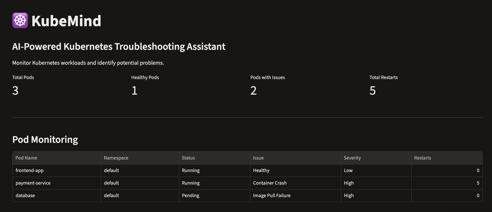
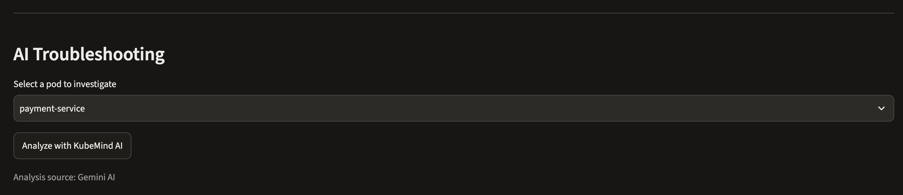
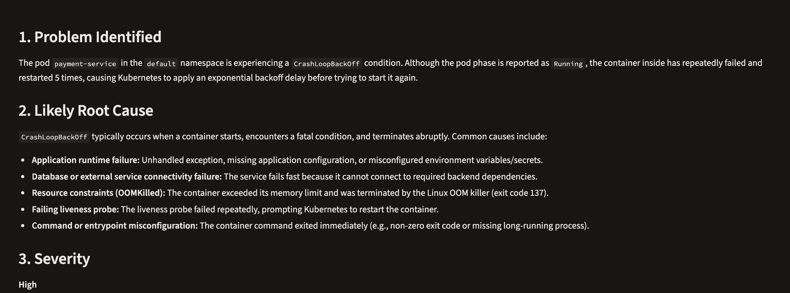
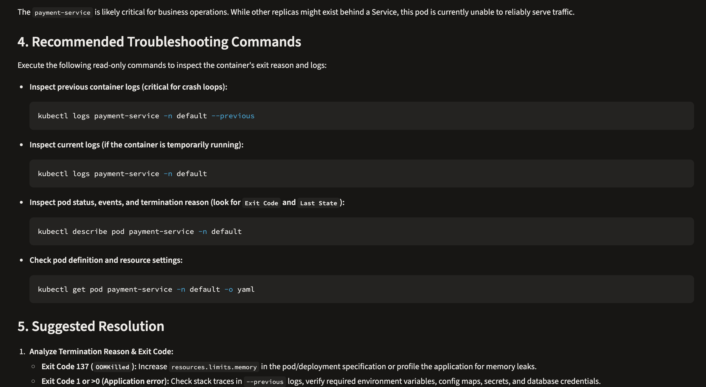
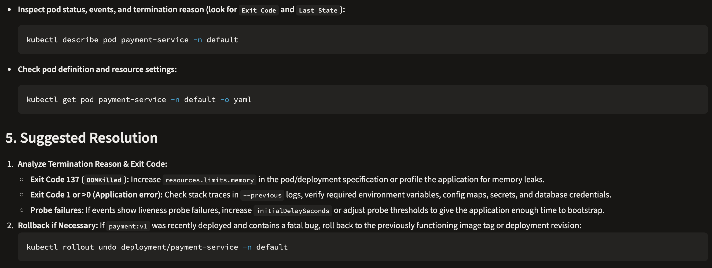

# ☸️ KubeMind AI – Kubernetes Troubleshooting Assistant

An AI-powered DevOps assistant that analyzes Kubernetes pod issues, identifies potential root causes, and recommends troubleshooting steps using **Google Gemini AI**.

KubeMind combines Kubernetes diagnostics with AI-generated insights to simplify infrastructure monitoring and troubleshooting.

## 📸 Dashboard Preview











## ✨ Features

- **AI-Powered Troubleshooting:** Uses Google Gemini to analyze Kubernetes pod information and generate diagnostic reports.
- **Automated Diagnostics:** Detects common issues such as `CrashLoopBackOff`, `ImagePullBackOff`, and `Pending` pods.
- **Severity Classification:** Categorizes detected issues based on their potential impact.
- **Troubleshooting Recommendations:** Generates relevant `kubectl` commands and suggested resolutions.
- **Interactive Dashboard:** Displays pod health, restart counts, and detected issues through Streamlit.
- **Rule-Based Fallback:** Provides basic diagnostic insights when AI analysis is unavailable.
- **Modular Architecture:** Separates Kubernetes diagnostics, AI analysis, and dashboard functionality.

## 🛠️ Tech Stack

| Technology | Purpose |
|---|---|
| Python | Core application |
| Streamlit | Interactive dashboard |
| Google Gemini API | AI-powered analysis |
| Kubernetes Python Client | Kubernetes interaction |
| python-dotenv | Environment configuration |
| Pytest | Automated testing |

## 📂 Project Structure

```text
kubemind-ai/
│
├── app/
│   ├── main.py
│   └── dashboard.py
│
├── kubemind/
│   ├── cluster.py
│   ├── diagnostics.py
│   └── logs.py
│
├── ai_engine/
│   └── analyzer.py
│
├── tests/
│   ├── test_cluster.py
│   └── test_diagnostics.py
│
├── media/
│   ├── img01.png
│   ├── img02.png
│   ├── img03.png
│   ├── img04.png
│   └── img05.png
│
├── requirements.txt
├── .env.example
├── .gitignore
└── README.md
```

## ⚙️ Getting Started

### 1. Clone the repository

```bash
git clone https://github.com/ShravyaMalogi/kubemind-ai.git
cd kubemind-ai
```

### 2. Install dependencies

```bash
pip install -r requirements.txt
```

### 3. Configure environment variables

Create a `.env` file in the project root and add your Gemini API credentials:

```env
GEMINI_API_KEY=your_gemini_api_key
GEMINI_MODEL=gemini-3.8-flash
```

Get your API key from [Google AI Studio](https://aistudio.google.com/apikey).

**Note:** Never commit your `.env` file or expose your API key publicly.

### 4. Run the application

```bash
streamlit run app/dashboard.py
```

Open the local URL displayed in your terminal to access the dashboard.

## 🧪 Running Tests

Run the automated test suite using:

```bash
pytest -v
```

## 🔮 Future Enhancements

- Live Kubernetes cluster integration.
- Real-time pod monitoring and diagnostics.
- Automated detection of resource and configuration issues.

---

**KubeMind AI** explores the intersection of **Artificial Intelligence, Kubernetes, and DevOps**, making infrastructure troubleshooting more accessible through intelligent diagnostics and AI-powered recommendations.
